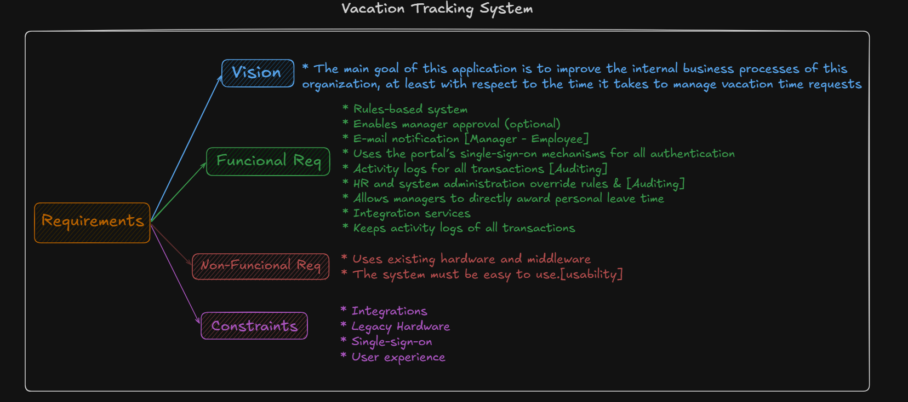
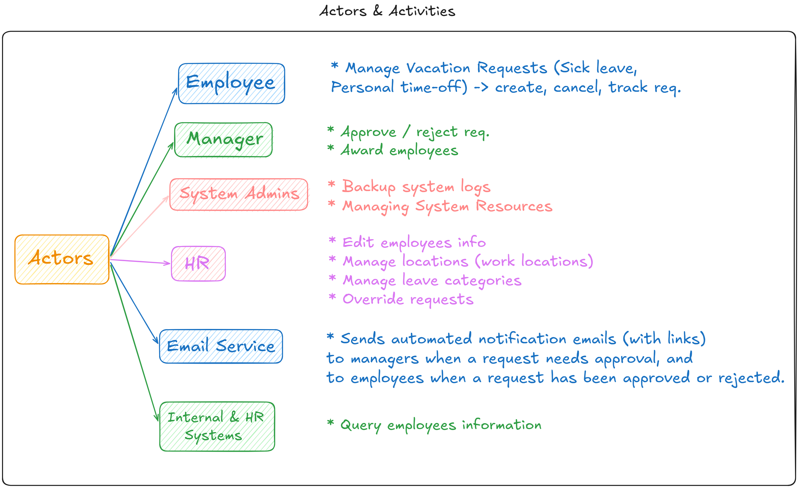
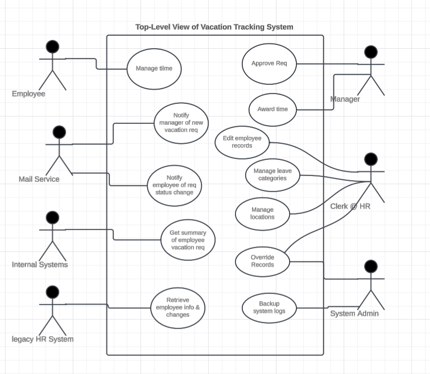

# vacation-tracking-system

## Problem Statement

- For many businesses today, the independence of workers has been ever increasing. It is not uncommon for workers to divide their time across multiple projects and to report to multiple project managers.

- As a result, managers have fewer informal interactions with their workers and find it increasingly difficult to be aware of and manage their workers’ vacation time.

## Requirements (Vision, Functional, Non-Functional, Constraints)

- A Vacation Tracking System (VTS) will provide individual employees with the capability to manage their own vacation time, sick leave, and personal time off, without having to be an expert in company policy or the local facility’s leave policies.

## Notes Regarding Non-Fucntional Requirements

> such a vague requirement that should never be recorded as an official requirement can make the system fail if not met from the endusers point-of-view

- such vague requirement can't be verified, or tested. but, they exist so they can be used to support and justify other, more concrete requirements or design decisions.

- what is meant by **easy to use**? consider a system that requires enduser to write text in formatted style (bold, italics, lists). would a system that lets users enter special key-codes to apply such effect be easier to use than one with built-in functionality to apply them on the users behalf ?

- however, if ease of use was desired rather than a critical requirement. the added complexity to provide ease of use could not be justified

## Domain

### The system solve 2 problems

1. Let Employees contorl their vacations.

   - give individual employees the capability and responsibility to **manage** their vacations (sick leave, personal time off, ...) with respect to their employment agreements with the company.

   - which result in a sense of empowerment to the employees.

2. Streamline the functions of the human resources (HR) department

     - to minimize noncore, business-related activities of management.
  
## Actors

## System Top Level View

---

## Flows and Use Cases

- while building a system, we should start with the most siginificant features that shape the project architecture and the system’s behavior

- the core use-case of the system is to allow employees to manage their vacation time (Manage Time)

> each use-case (main/alternate) flow will be in a dedicated directory

- we will follow this for formatting use cases:
  - use case name
  - actors
  - goal
  - preconditions
  - main flow
  - data model
  - alternate flows (seprate from main flow)

### Use Cases

1. **Manage Time**: happy scenario. allow employees to manage their vacations (sick leave, personal time off, ...)

2. **Withdraw Request** (alternate flow from `Manage Time`): The employee wants to withdraw an outstanding request for vacation time
