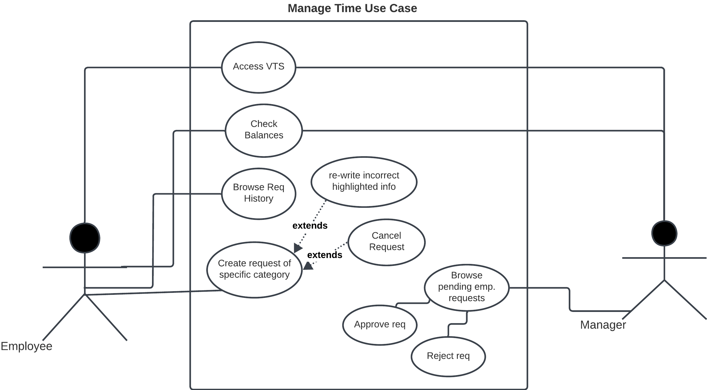
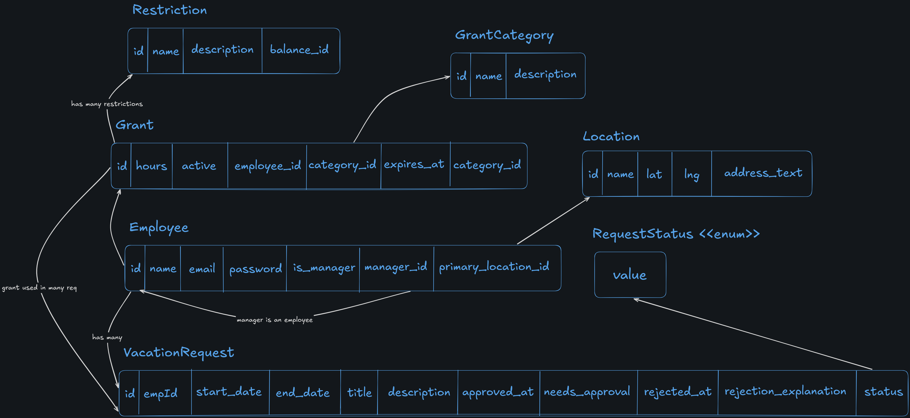
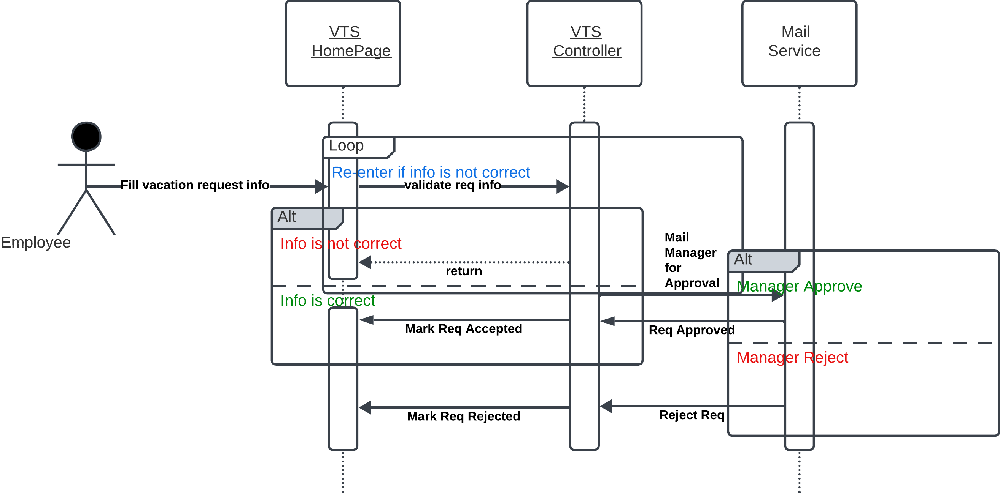

# vacation-tracking-system

## Problem Statement

- For many businesses today, the independence of workers has been ever increasing. It is not uncommon for workers to divide their time across multiple projects and to report to multiple project managers.

- As a result, managers have fewer informal interactions with their workers and find it increasingly difficult to be aware of and manage their workers’ vacation time.

## Decision

- so, the company decided to build a flexible vacation time management application for managers and employees alike to use to manage their vacation time.

## Vision

- A Vacation Tracking System (VTS) will provide individual employees with the capability to manage their own vacation time, sick leave, and personal time off, without having to be an expert in company policy or the local facility’s leave policies.

## Functional Requirements

- Enables manager approval (optional)

- Provides access to requests for the previous calendar year, and allows requests to be made up to a year and a half in the future

- Uses e-mail notification to request manager approval and notify employees of request status changes

- Keeps activity logs for all transactions

- Enables the HR and system administration personnel to override all actions restricted by rules, with logging of those overrides

- Allows managers to directly award personal leave time (with system-set limits)

- Provides a Web service interface for other internal systems to query any given employee’s vacation request summary

- Interfaces with the HR department legacy systems to retrieve required employee information and changes

## Non-Functional Requirements

- The system should be easy to use

- Implements a **flexible** rules-based system for validating and verifying leave time requests

- Uses existing hardware and middleware

- Is implemented as an extension to the existing intranet portal system, and uses the portal’s single-sign-on mechanisms for all authentication

## Notes Regarding Non-Fucntional Requirements

> such a vague requirement that should never be recorded as an official requirement can make the system fail if not met from the endusers point-of-view

- such vague requirement can't be verified, or tested. but, they exist so they can be used to support and justify other, more concrete requirements or design decisions.

- what is meant by **easy to use**? consider a system that requires enduser to write text in formatted style (bold, italics, lists). would a system that lets users enter special key-codes to apply such effect be easier to use than one with built-in functionality to apply them on the users behalf ?

- however, if ease of use was desired rather than a critical requirement. the added complexity to provide ease of use could not be justified

## Constraints

- **past** requests's access must be within the previous calendar year.

- **future** requests's access must be up to a year and a half in the future

- mail notifications must be sent in case of employee req status change, or awarded time leave from manager

- mail notifications must be sent to direct manager if an employee requested a time leave

- all transactions must be logged (req made, req approve, req reject, req status overrided)

## Domain

- The system solve 2 problems:

1. Let Employees contorl their vacations. give individual employees the capability and responsibility to **manage** this particular aspect of their employment agreements with the company. which result in a sense of empowerment to the employees.

2. Streamline the functions of the human resources (HR) department, to minimize noncore, business-related activities of management.
  
## Actors

- employees:  main user of this system. use the system to manage his/her vacation time

- managers: approve/reject requests, award employees

- HRs: manage recodrds (browse, add, delete)

- System Admins: responsible for the smooth running of the system’s technical resources (servers, DBs). and  for collecting & archiving system logs

- mail service: notify employee & managers for requests & status changes

- internal systems: query any given employee’s vacation request summary

- HR legacy systems: retrieve employee information and changes

## System Top Level View


---

### Manage Time Use Case

- while building a system, we should start with the most siginificant features that shape the project architecture and the system’s behavior

- the core use-case of the system is to allow employees to manage their vacation time (Manage Time)

- we will follow this for formatting use cases:
  - use case name
  - actors
  - goal
  - preconditions
  - main flow
  - alternate flows

#### Use Case Name: Manage Time

#### Actors: employees

#### Goal: employee submits a request for vacation time

#### Preconditions: employee is authenticated by the portal framework, and identified as employee with privilages to manage his/her vacation time

#### Main Flow

1. The employee begins by selecting a link from the intranet portal to the VTS.

2. The VTS uses the employee’s credentials to look up the current status of all the employee’s vacation time requests and outstanding balances. Information is displayed for the previous 6 months and up to 18 months in the future.

3. The employee wants to create a new request. The employee selects one of the categories of vacation time with a positive balance to use.

4. The VTS prompts the employee for the date(s) and time for which to request vacation time. The employee should have access to a visual calendar to help select and compare chosen dates.

5. The employee selects the desired dates and hours per date (e.g., four hours might indicate a half-day vacation time request). The employee enters a short title and description (no more than a paragraph in length) so that the manager will have more information with which to approve this request. When all the information is entered, the employee submits the request.

6. If the submitted information is incomplete or incorrect or does not pass validation, the Web page is redisplayed, with the errors highlighted and documented.

7. The employee has an opportunity to change the information or cancel the request.

8. If the information is complete and passes validation, the employee is returned to the main VTS home page. If the employee’s vacation time requests require manager approval, an e-mail is immediately sent to the manager(s) authorized to approve the employee’s requests.

9. The vacation time request is placed in a state of pending approval.

10. The manager responds to the e-mail by clicking on a link embedded in the e-mail or by explicitly logging into the intranet portal and navigating to the main VTS home page.

11. The manager may be required to supply necessary authentication credentials to gain access to the portal and VTS application.

12. The VTS home page lists the manager’s own vacation time requests and outstanding balances but also has a separate section listing
requests pending approval by subordinate employees. The manager selects each of these one at a time to individually approve or deny.

13. The VTS displays the details of the requested time and prompts the manager to approve or disapprove the request. If the request is disapproved, the manager is required to enter an explanation. Once the manager submits the result, the internal state of the request is changed to approved or rejected.

14. Whether a request is approved or rejected, an e-mail notification is immediately sent to the employee who made the request. The manager’s screen returns to the main VTS home page, and the manager may approve other outstanding requests, make a request for him- or
herself, or simply leave the VTS application.



#### Notes on main flow

- the following are kept out of the diagram:
  - UI elements (mouse click, browser open, redirect link)
  - Durations & system actions (6-months, query DB)
  - atomic technical operations (choose date, fill username)
  - trigger mail sent event (not a use-case, but action outcomes)

---

### Data Model & ERD

#### Classes

- Employee (name, email, password, isManager, managerId, _primaryLocationId_)

- Location (name, lat, lng, addressText)

- VacationRequest (_employeeId_, category, startDate, endDate, title, description, needsApproval, approvedAt, rejectedAt, rejectioneExplanation, status)

- RequestCategory (name, description)

- VacationBalance (_employeeId_, _categoryId_, hours, expiresAt, active)

- Restriction (_vacationBalanceId_, name, description)

#### Enums

- RequestStatus (PENDING, APPROVED, REJECTED, CANCELLED)



#### Notes on Data Model (Design Decisions)

- should categories be modeled as `enums`, or separate `entities` ?
  - if it has no behavior (just a type), it doesn't need to be an entity (classes are about behavior)
  - if it has logic, or we need to keep track of audit information about them (when created, active/not, ...), it should be an entity
  - we need to keep track of balance associated with each category for each employee => better to model it as an entity

- when to use `isApproved` vs. `approvedAt`?
  - boolean flags are better for storage optimization
  - timestamps are better for auditity
  - since the system needs to log every trx, we may need timestamps

---

### Flowchart


---

### Sequence Diagram



---

### Pseudocode

```java
submitVacationRequest(data) {

  errors = validate(data);
  if (errors.length > 0) {
      return Bad_Request(errors);
  }

  if (data.needsApproval) {
      sendEmailToManagers(data);
  } else {
      data.request.status = STATUS.APPROVED;
  }

  return Ok();
}  
```
