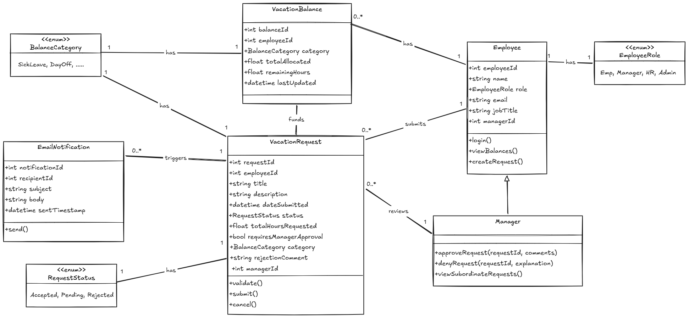
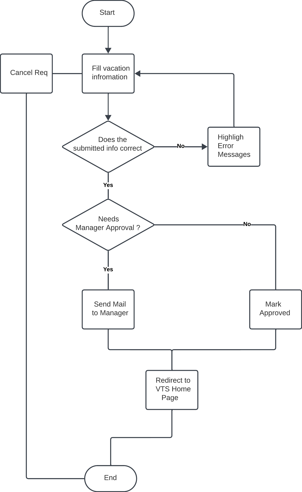

# Manage Time Flow

- while building a system, we should start with the most siginificant features that shape the project architecture and the system’s behavior

- the core use-case of the system is to allow employees to manage their vacation time (Manage Time)

- we will follow this for formatting use cases:
  - use case name
  - actors
  - goal
  - preconditions
  - main flow
  - alternate flows

## Use Case Name: Manage Time

## Actors: employees, managers

## Goal: employee submits a request for vacation time

## Preconditions: employee is authenticated by the portal framework, and identified as employee with privilages to manage his/her vacation time

## Flow

1. The employee begins by selecting a link from the intranet portal to the VTS.

2. The VTS uses the employee’s credentials to look up the current status of all the employee’s vacation time requests and outstanding balances. Information is displayed for the previous 6 months and up to 18 months in the future.

3. The employee wants to create a new request. The employee selects one of the categories of vacation time with a positive balance to use.

4. The VTS prompts the employee for the date(s) and time for which to request vacation time. The employee should have access to a visual calendar to help select and compare chosen dates.

5. The employee selects the desired dates and hours per date (e.g., four hours might indicate a half-day vacation time request). The employee enters a short title and description (no more than a paragraph in length) so that the manager will have more information with which to approve this request. When all the information is entered, the employee submits the request.

6. If the submitted information is incomplete or incorrect or does not pass validation, the Web page is redisplayed, with the errors highlighted and documented.

7. The employee has an opportunity to change the information or cancel the request.

8. If the information is complete and passes validation, the employee is returned to the main VTS home page. If the employee’s vacation time requests require manager approval, an e-mail is immediately sent to the manager(s) authorized to approve the employee’s requests.

9. The vacation time request is placed in a state of pending approval.

10. The manager responds to the e-mail by clicking on a link embedded in the e-mail or by explicitly logging into the intranet portal and navigating to the main VTS home page.

11. The manager may be required to supply necessary authentication credentials to gain access to the portal and VTS application.

12. The VTS home page lists the manager’s own vacation time requests and outstanding balances but also has a separate section listing
requests pending approval by subordinate employees. The manager selects each of these one at a time to individually approve or deny.

13. The VTS displays the details of the requested time and prompts the manager to approve or disapprove the request. If the request is disapproved, the manager is required to enter an explanation. Once the manager submits the result, the internal state of the request is changed to approved or rejected.

14. Whether a request is approved or rejected, an e-mail notification is immediately sent to the employee who made the request. The manager’s screen returns to the main VTS home page, and the manager may approve other outstanding requests, make a request for him- or
herself, or simply leave the VTS application.


### Notes on main flow

- the following are kept out of the diagram:
  - UI elements (mouse click, browser open, redirect link)
  - Durations & system actions (6-months, query DB)
  - atomic technical operations (choose date, fill username)
  - trigger mail sent event (not a use-case, but action outcomes)

---

## Data Model & ERD

### Classes



### Notes on Data Model (Design Decisions)

- should we have `VacationType`, `VacationStatus`, `RequestCategories` as entities, or enums?
  - if it has no behavior (just a type), it doesn't need to be an entity (classes are about behavior)
  - if it has logic, or we need to keep track of audit information about them (when created, active/not, ...), it should be an entity

- when to use `isApproved` vs. `approvedAt`?
  - boolean flags are better for storage optimization
  - timestamps are better for auditity
  - since the system needs to log every trx, we may need timestamps

- why do we store `managerId` in the request? can't we just get it from `Employee` ?
  - auditing (who approved at the time of that request, as manager may change)
  - avoid joins for a common/critical operations
  - current manager maybe busy, so we delegate to another manager (approvedBy)

- at DB-level and App-level, should `Employee`, and `Manager` be the same class?

---

## Flowchart



---

## Sequence Diagram


---

## Pseudocode

```java
submitVacationRequest(data) {

  errors = validate(data);
  if (errors.length > 0) {
      return Bad_Request(errors);
  }

  if (data.needsApproval) {
      sendEmailToManagers(data);
  } else {
      data.request.status = STATUS.APPROVED;
  }

  return Ok();
}  
```
