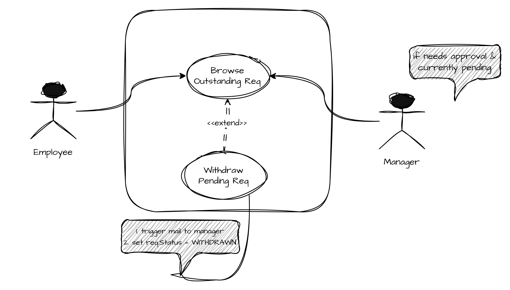
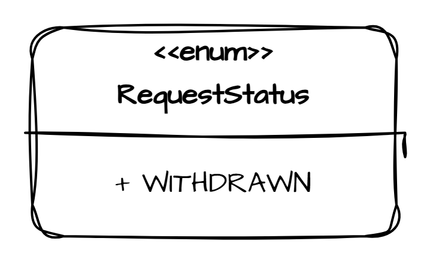
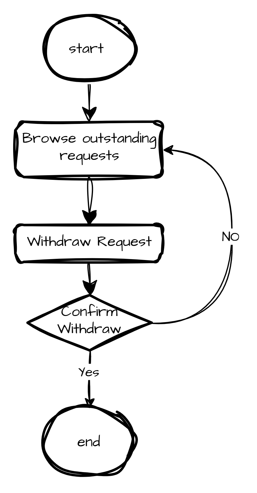
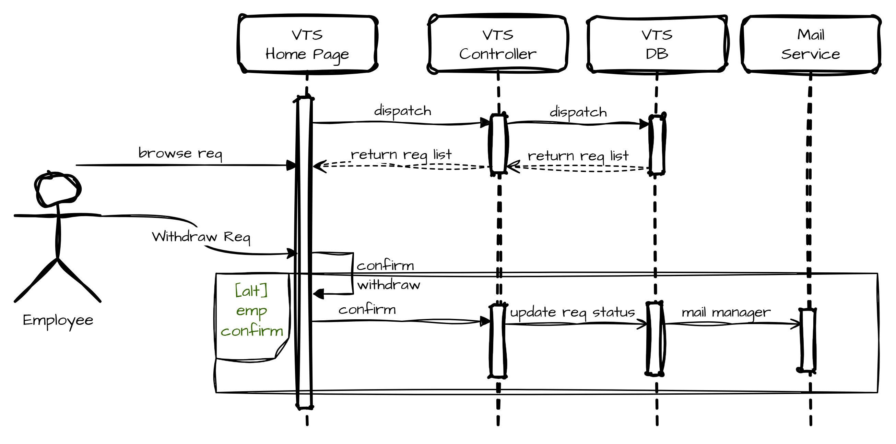

# Withdraw Request Flow

## Use Case Name: Withdraw Request

## Actors: employee, manager

## Goal: employee want to withdraw an outstanding request for vacation time

## Preconditions

- employee is authenticated by the portal framework, and identified as employee with privilages to manage his/her vacation time

- employee has made a request

- employee request is pending approval (not accepted, nor rejected)

## Flow

1. The employee navigates to the VTS home page through the intranet portal application, which identifies and authenticates the employee with the privileges necessary for using the VTS.

2. The VTS home page contains a summary of vacation time requests, outstanding balances per category of time, and the current status of all active vacation time requests for the previous 6 months and up to 18 months in the future.

3. The employee selects a vacation time request to withdraw, one that is currently pending approval.

4. The VTS prompts the employee to confirm the request to withdraw the previously submitted vacation time request.

5. The employee confirms the desire to withdraw, and the request is removed from the manager’s list of pending approvals.

6. The system sends a notification e-mail to the manager.

7. The system updates the request state to withdrawn.



---

## Data Model Effects

- add `Withdrawn` as a `RequestStatus`



---

## Flowchart



---

## Sequence Diagram



---

## Pseudocode

```java
@PutMapping("/requests/withdraw")
withdrawVacationRequest(RequestDto dto) {
    ApiResponse res = service.withdrawRequest(dto);
    return Response.status(e.status).body(e.getBody());
}

service.withdrawRequest(RequestDto dto) throws InvalidRequestException {
  validateDto(dto); // throws InvalidRequestException
  reqRepo.save(dto.toEntity());
  notifyManager(dto.managerId);
}

@Async
notifyManager(Long managerId) {
  // ...
}
```
