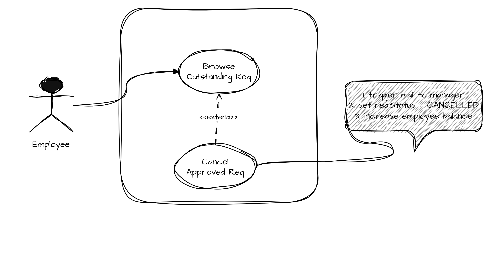
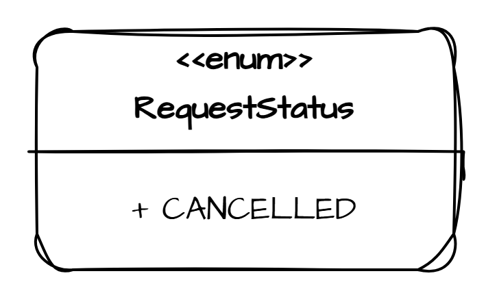
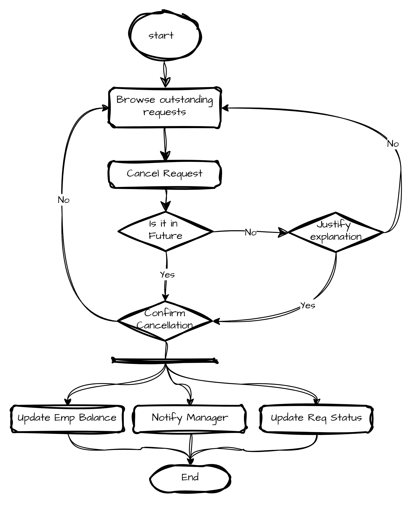
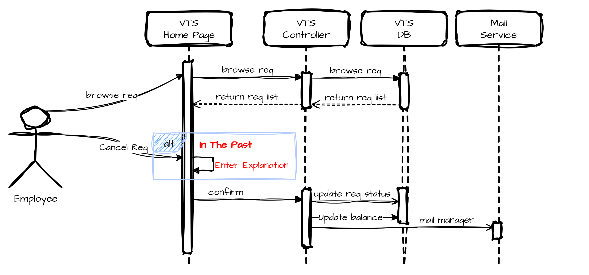

# Cancel Approved Request

## Use Case Name: Cancel Approved Request

## Actors: employee

## Goal: employee want to cancel an approved request for vacation time

## Preconditions

- employee is authenticated by the portal framework, and identified as employee with privilages to manage his/her vacation time

- employee has made a request

- request has been approved (scheduled in recent past, or future)

## Flow

1. The employee navigates to the VTS home page through the intranet portal application, which identifies and authenticates the employee with the privileges necessary for using the VTS.

2. The VTS home page contains a summary of vacation time requests, outstanding balance per category of time, and the current status of all active vacation time requests for the previous 6 months and up to 18 months in the future.

3. The employee selects a vacation time request to cancel, one that is in the future (or recent past) and has been approved.

4. If the request is in the future, the employee is prompted to confirm the cancellation. If the request is in the recent past, the employee is prompted to confirm the cancellation and provide a short explanation. If the employee approves the cancellation and provides the required information, an e-mail notification is sent to the manager, and the state of the request is changed to canceled. The time allowances used to make the request are returned to the employee. The employee can also abort the cancellation, effecting no changes to the current requests.

5. The employee is returned to the main VTS home page. The summaries are updated to reflect any changes made to the employee’s outstanding vacation time requests.



---

## Data Model Effects

- add `Withdrawn` as a `RequestStatus`



---

## Flowchart



---

## Sequence Diagram



---

## Pseudocode

```java
@PutMapping("/requests/withdraw")
cancelVacationRequest(RequestDto dto) {
    ApiResponse res = service.cancelRequest(dto);
    return res;
}

service.cancelRequest(RequestDto dto) throws InvalidRequestException {
  validateDto(dto); // throws InvalidRequestException
  reqRepo.save(dto.toEntity());
  empRepo.updateBalance(dto.hours);
  notifyManager(dto.managerId);
}

@Async
notifyManager(Long managerId) {
  // ...
}
```
