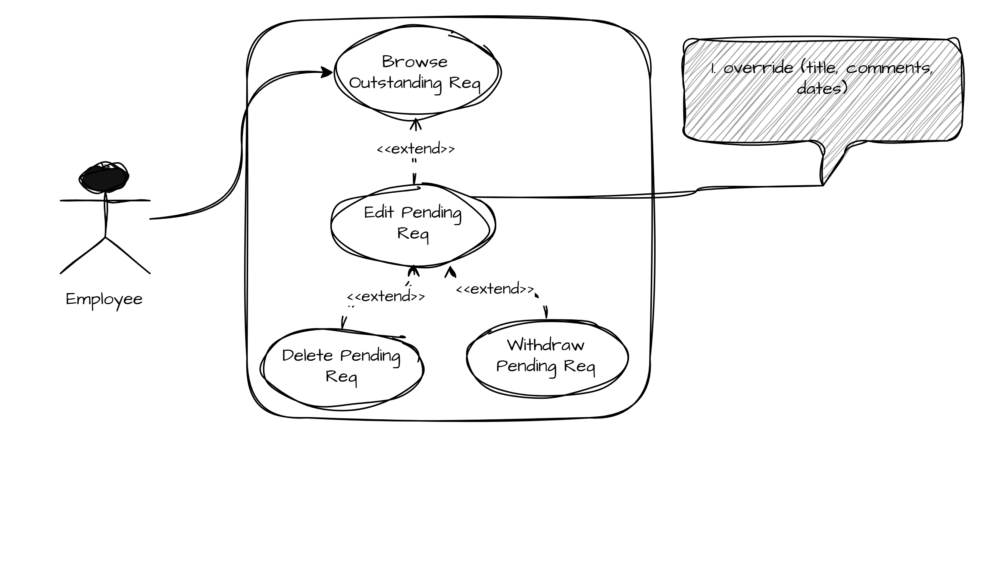
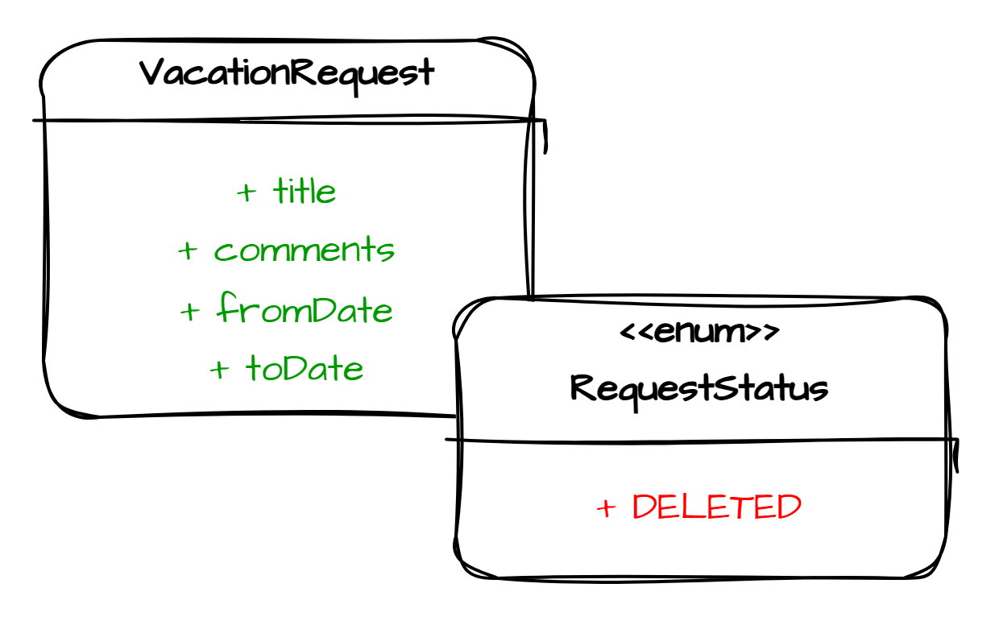
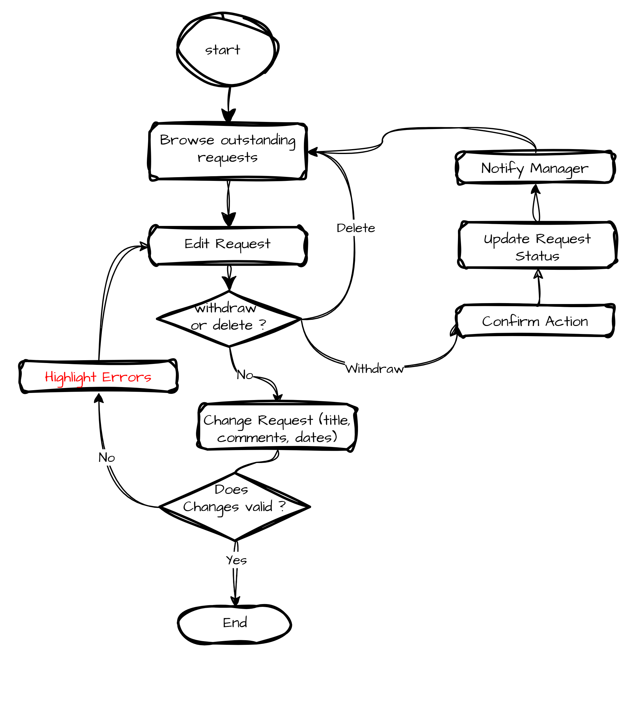
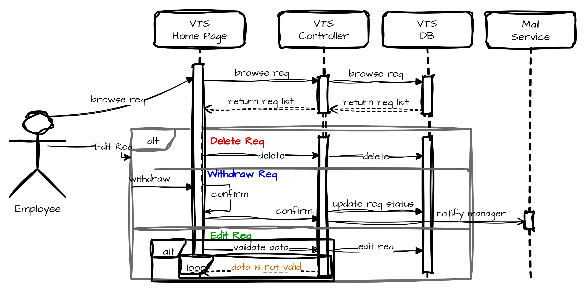

# Edit Pending Request

## Use Case Name: Edit Pending Request

## Actors: employee

## Goal: employee want to edit (description, title) of an outgoing pending request for vacation time

## Preconditions

- employee is authenticated by the portal framework, and identified as employee with privilages to manage his/her vacation time

- employee has made a request

- request is pending (not accepted, nor rejected)

## Flow

1. The employee navigates to the VTS home page through the intranet portal application, which identifies and authenticates the employee with the privileges necessary for using the VTS.

2. The VTS home page contains a summary of vacation time requests, outstanding balances per category of time, and the current status of all active vacation time requests for the previous 6 months and up to 18 months in the future.

3. The employee selects a request to edit, one that is pending approval.

4. The VTS displays an editable view of the request. The employee is allowed to change the title, comments, or dates. The employee can also choose to delete or withdraw this request.

5. The employee changes request information and submits the changes to the system.

6. If the employee withdraws the request, the VTS prompts for confirmation before withdrawing the request. If changes are made only to the information, the changes are accepted, and the screen returns to the main VTS home page. If there are errors or problems with the information changes, the VTS redisplays the editing page and highlights and explains all problems.



---

## Data Model Effects

- add `DELETED` as a `RequestStatus`

- make sure `VacationRequest` has (title, comments, dates)



---

## Flowchart



---

## Sequence Diagram



---

## Pseudocode

```java
@PutMapping("/requests/withdraw")
editVacationRequest(RequestDto dto) {
    ApiResponse res = service.editRequest(dto);
    return res;
}

service.editRequest(RequestDto dto) throws InvalidRequestException {
  validateDto(dto); // throws InvalidRequestException
  reqRepo.save(dto.toEntity());
}

validateDto(RequestDto dto) throws InvalidRequestException {
  // title within allowed length
  // comments within allowed length
  // dates within allowed range
}

@Async
notifyManager(Long managerId) {
  // ...
}
```
